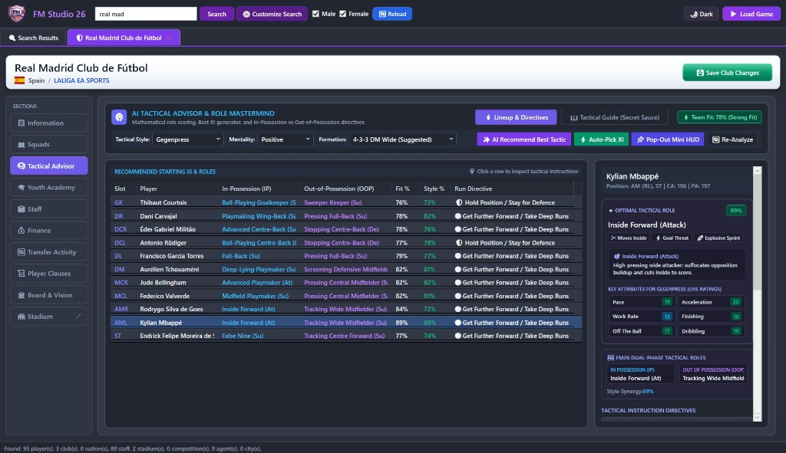
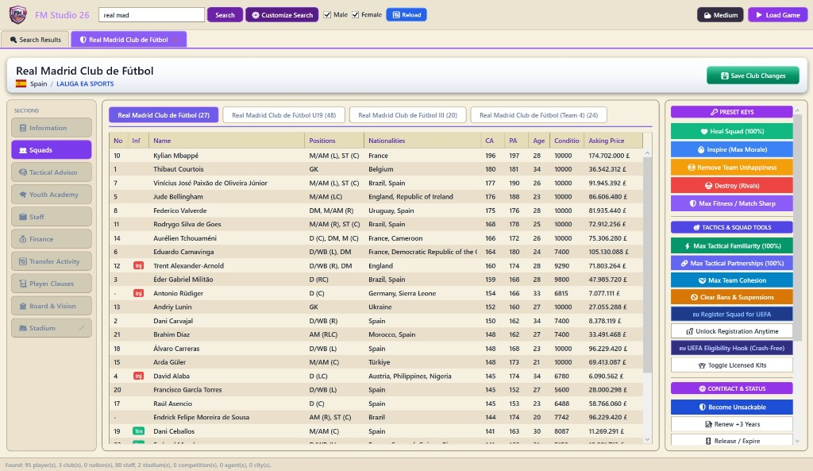
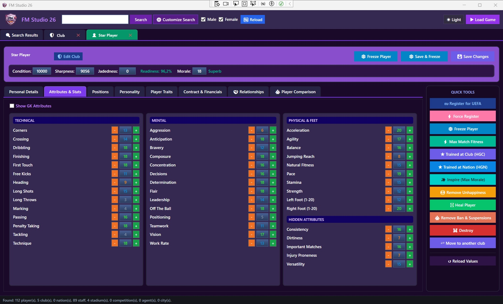
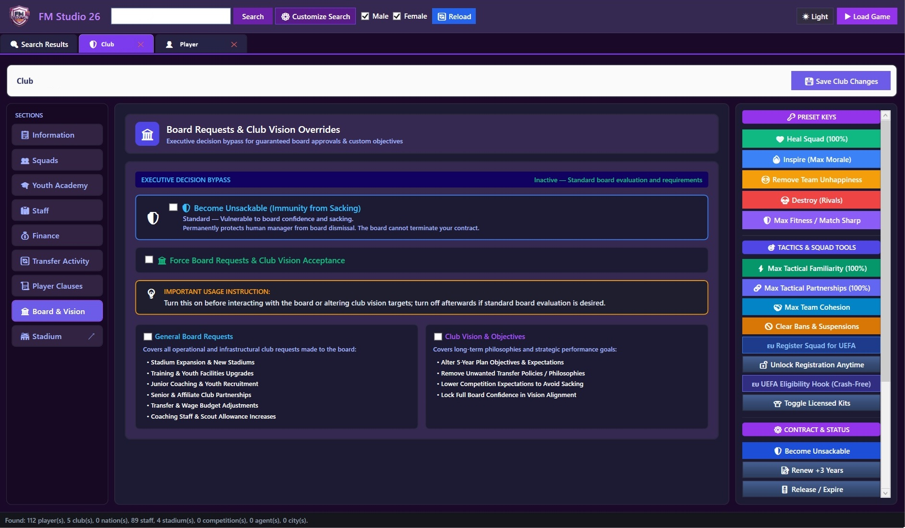

# FM26 Studio

> **The Next-Generation Real-Time In-Game Memory Editor & AI Tactical Mastermind for Football Manager 2026**

[](https://github.com/)
[](https://dotnet.microsoft.com/)
[](https://www.footballmanager.com/)

---

## 🌟 Overview

**FM26 Studio** is an advanced, high-performance real-time memory editor and tactical assistant specifically engineered for **Football Manager 2026**. Built on modern **.NET 10** and **WPF**, it communicates directly with the live FM26 process memory to provide instantaneous inspection, editing, and tactical analysis with zero game pauses or save-game reloading.

---

## 📸 Screenshots & Showcase

<p align="center">
  
  
</p>
<p align="center">
  
  
</p>

---

## ⚡ Core Features

### 1. 🧠 AI Tactical Mastermind & Tactical Advisor
* **12 Authentic FM26 Formations**: Full support for all official formations:
  * `3-2-4-1`
  * `4-2-2-2 AM Narrow`
  * `4-2-3-1 DM Wide (Suggested)`
  * `4-3-3 DM Wide (Suggested)`
  * `4-4-2 Diamond Narrow`
  * `4-2-4 DM Wide`
  * `4-2-2-2 DM Wide`
  * `4-3-2-1 DM Narrow`
  * `5-2-1-2 DM WB`
  * `3-4-3 DM Narrow`
  * `3-4-3 DM Wide (Suggested)`
  * `5-1-2-2 DM WB`
* **FM26 Dual-Role System**: Authentic support for separate **In-Possession (IP)** and **Out-of-Possession (OOP)** player roles:
  * *Goalkeepers*: Ball-Playing Goalkeeper, No-Nonsense Goalkeeper, Sweeper Keeper, Line-Holding Keeper.
  * *Defenders*: Advanced Centre-Back, Ball-Playing Centre-Back, Stopping/Covering Centre-Back, Inside Wing-Back, Playmaking Wing-Back, Pressing/Holding Full-Back.
  * *Midfielders*: Deep-Lying Playmaker, Box-to-Box Playmaker, Half Back, Channel Midfielder, Screening/Pressing Central Midfielder.
  * *Attackers*: Inside Forward, Wide Forward, Playmaking Winger, False Nine, Channel Forward, Poacher, Target Forward.
* **Optimal Tactic Recommender**: Mathematically evaluates 120 tactical systems (12 Formations × 10 Tactical Styles) against your squad attributes to select the highest-synergy tactic, Starting XI, and 7 optimal bench substitutes.
* **Live Match Radar HUD**: Compact, draggable, resizable live overlay that monitors player fatigue (<68% condition), yellow/red card risk, and provides dynamic in-game tactical counters.

---

### 2. ⚽ Complete Real-Time In-Game Editor Suite
* **Player Editor**:
  * Edit attributes (1–20), Current Ability (CA), Potential Ability (PA), and hidden attributes.
  * Instant injury recovery / healing and condition restorer.
  * Contract dates, wages, clauses, and squad status.
  * International data, caps, goals, and dual nationalities.
* **Club Editor**:
  * Finances: Balance, transfer budget, wage budget, youth funding.
  * Reputation, morale, facilities, training grounds, and youth recruitment.
  * Multi-squad support (First Team, Reserves, Under-21, Under-19).
* **Stadium Editor**:
  * Capacity, seated capacity, expansion capacity, and stadium condition.
* **Staff Editor**:
  * Non-player coaching, medical, and scouting attributes.
  * Tactical style and formation preferences.
* **Competitions & Tables**:
  * Universal multi-engine string parser supporting MSVC `std::string` inline SSO and heap pointers.
  * Standings, stages, and history browser.

---

### 3. 🎨 Modern Adaptive UI & Multi-Skin Engine
* Dedicated **Dark Skin**, **Light Skin**, and **Medium Skin** with semantic brush system.
* High-contrast vector SVG icons and sleek responsive data grids.
* Resizable floating windows with horizontal and vertical scrolling.

---

## 🛠️ Technology Stack

* **Language**: C# 13 / .NET 10.0 Windows Desktop
* **UI**: Windows Presentation Foundation (WPF) with dynamic skin themes
* **Memory Architecture**: Direct Win32 memory interop (`ReadProcessMemory`, `WriteProcessMemory`, Native RTTI probing)
* **Target OS**: Windows 10 / Windows 11 (64-bit)

---

## 🚀 Building & Running

### Prerequisites
* Windows 10/11 64-bit
* [.NET 10.0 SDK](https://dotnet.microsoft.com/download/dotnet/10.0) or Visual Studio 2026 / 2022 (v17.12+)

### Clone & Build
```powershell
# Build in Release mode
dotnet build -c Release
```

---

## ⚠️ Disclaimer
*FM26 Studio is an independent community development tool and is not affiliated with, endorsed by, or connected to Sports Interactive or SEGA.*
